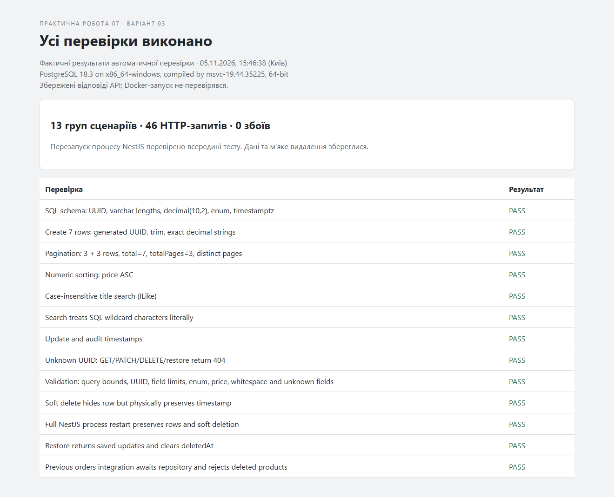
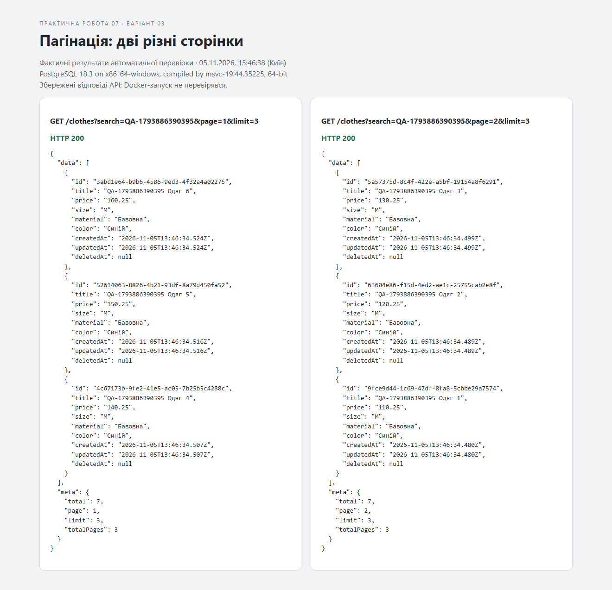
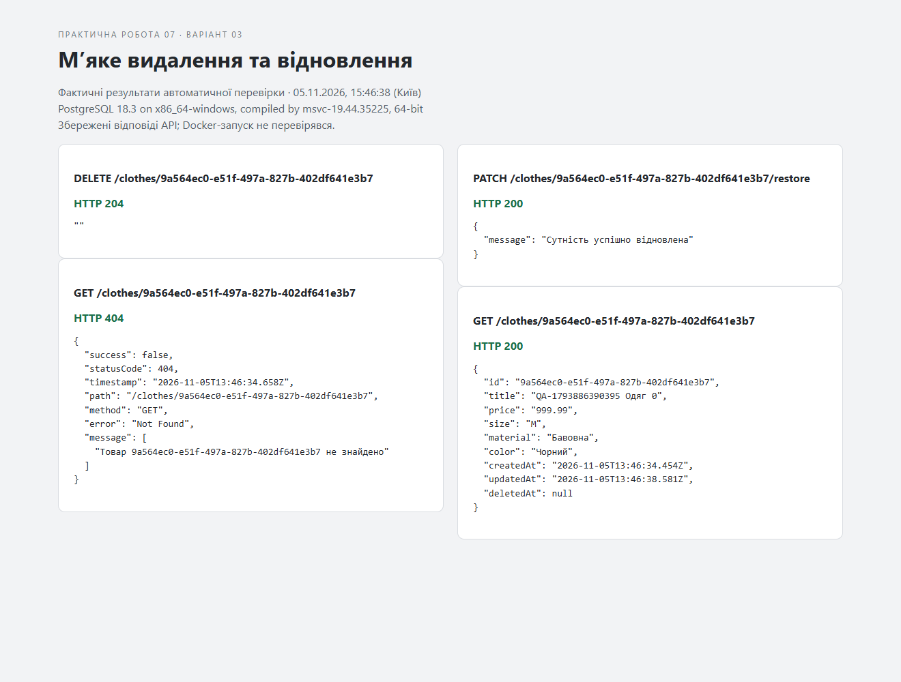
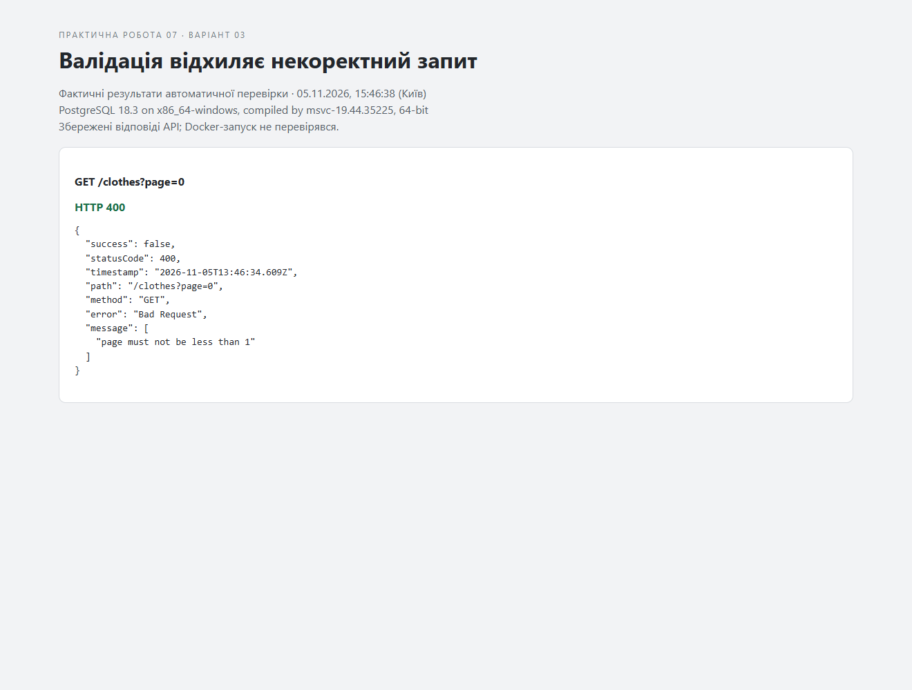

# Практична робота №7 — TypeORM та PostgreSQL

**Номер у журналі: 23. Варіант: `((23 - 1) % 10) + 1 = 3` — «Одяг та взуття».**

Мета: перенести каталог одягу з оперативної пам’яті в PostgreSQL, реалізувати CRUD через TypeORM, пагінацію, пошук, сортування, м’яке видалення та відновлення.

## Основа та обсяг роботи

Проєкт створено як окрему копію реальної практичної №6 з `C:\Users\vadim\Desktop\lab6WEB`. Це відповідає постановці завдання: замінити in-memory сховище попередніх робіт на базу даних. Шосту практичну не змінено.

Збережено NestJS, глобальну валідацію, TrimPipe, HTTP middleware, фільтр помилок, інтерцептор часу відповіді, спільні провайдери та маршрути замовлень. Предметна область не змінена. Каталог більше не створює автоматично два товари під час запуску: демонстраційні дані додаються окремою командою `npm run seed` або через `requests.http`.

Усі три рівні реалізовано в коді. API перевірено на справжньому PostgreSQL 18.3. **Docker-запуск із PostgreSQL 16 не перевірено: Docker CLI на комп’ютері відсутній.** Цей пункт потребує перевірки в середовищі Docker перед здачею. Вихідний код підготовлено до публікації; віддалений Git-репозиторій у межах цієї роботи не створювався.

## Запуск через Docker Compose

Потрібні Node.js 20+ (перевірено на 22.23.3), npm та запущений Docker Engine із Compose V2. Розпакуйте архів і відкрийте термінал у папці `lab7WEB`.

```powershell
npm ci
docker compose up -d --wait
docker compose ps
npm run build
npm start
```

API: `http://localhost:3000`. В іншому терміналі в тій самій папці:

```powershell
npm run seed
```

Ця команда додає сім демонстраційних товарів і пропускає вже наявні товари з тими самими назвами. Альтернатива — виконати сім POST-запитів із `requests.http` у VS Code через REST Client. Повторне ручне виконання POST створює новий запис.

Якщо порт 5432 зайнято локальним PostgreSQL, перед запуском Compose та API в їхніх терміналах встановіть:

```powershell
$env:DB_PORT = '55433'
```

Compose опублікує контейнер на цьому порту; застосунок прочитає той самий параметр. За замовчуванням зовнішній і внутрішній порт — 5432. Зупинка API — `Ctrl+C`; контейнера — `docker compose down`. Іменований том `pgdata` зберігає дані після зупинки контейнера.

Для режиму розробки: `npm run start:dev`. Команда спочатку компілює проєкт і стежить за скомпільованими файлами. Після редагування TypeScript повторно запустіть `npm run build` в іншому терміналі.

## Налаштування підключення

| Змінна середовища | Типове значення |
|---|---|
| `DB_HOST` | `127.0.0.1` |
| `DB_PORT` | `5432` |
| `DB_USER` | `nest_user` |
| `DB_PASSWORD` | `nest_password` |
| `DB_NAME` | `store_db` |
| `PORT` | `3000` |
| `DB_LOGGING` | `false`; значення `true` вмикає SQL-журнал |

`.env.example` містить приклад значень. Сам застосунок читає змінні середовища процесу; файл `.env` автоматично використовується Compose лише для підстановок у YAML. Для API задавайте значення через `$env:...` у PowerShell.

`TypeOrmModule.forRoot()` використовує `autoLoadEntities: true` та `synchronize: true` за вимогою практичної. Автосинхронізація призначена для навчальної локальної бази; для production потрібні міграції. Compose задає ICU-локаль `uk-UA` для нової бази, щоб пошук українських назв без урахування регістру працював коректно. Параметри ініціалізації застосовуються лише до нового тому.

## Структура

```text
src/
  app.module.ts                         # TypeORM, модулі, middleware
  configure-app.ts                      # спільний конвеєр API й тестів
  clothes/
    entities/clothing.entity.ts         # таблиця clothes
    clothing.entity.ts                  # реекспорт для сумісності
    dto/                                # створення, оновлення, пагінація
    clothes.module.ts                   # TypeOrmModule.forFeature
    clothes.service.ts                  # @InjectRepository, асинхронний CRUD
    clothes.controller.ts               # REST і ParseUUIDPipe
  common/                               # конвеєр практичної №6
  orders/                               # попередній модуль, адаптований до async
  shared/                               # спільні провайдери та SlugService
  home/
scripts/seed.js                          # сім демонстраційних товарів
scripts/render-evidence.js               # скриншоти з фактичного JSON-журналу
test/api.test.js                        # наскрізна перевірка PostgreSQL
requests.http                           # ручні сценарії
docker-compose.yml                     # PostgreSQL 16, healthcheck, pgdata
evidence/                              # фактичні результати та знімки
```

## Рівень 1 — база даних і Entity

У Compose описано `postgres:16-alpine`, користувача, пароль, базу, порт і постійний том; застаріле поле `version` відсутнє. Додано healthcheck. У ClothesModule зареєстровано `TypeOrmModule.forFeature([ClothingEntity])`.

| Поле | Тип PostgreSQL |
|---|---|
| `id` | `uuid`, автоматично згенерований первинний ключ |
| `title` | `varchar(150)` |
| `price` | `decimal(10,2)` |
| `size` | enum: `XS`, `S`, `M`, `L`, `XL` |
| `material` | `varchar(80)` |
| `color` | `varchar(50)` |
| `createdAt` | `timestamp with time zone`, CreateDateColumn |
| `updatedAt` | `timestamp with time zone`, UpdateDateColumn |
| `deletedAt` | nullable `timestamp with time zone`, DeleteDateColumn |

Фактичне створення таблиці та enum зафіксовано в `evidence/server.log`. Типи, довжини та точність перевірено SQL-запитом до `information_schema.columns`; результат є в `evidence/results.json`.

На вході `price` — JSON-число з максимум двома десятковими знаками, більше нуля та не більше 99999999.99. На виході `price` — рядок, наприклад `"799.99"`: це зберігає точне представлення PostgreSQL numeric і відповідає прикладу завдання.

## Рівень 2 — Repository та CRUD

ClothesService отримує `Repository<ClothingEntity>` через `@InjectRepository()`. Створення використовує `create()` і `save()`, читання — `findOneBy()`, оновлення — перевірку існування та `save()`. Відсутній UUID повертає 404. Контролер перевіряє формат UUID до звернення в базу; неправильний формат повертає 400.

Рівень 3 замінює фізичне видалення рівня 2 на `softDelete()`. Список повертається в остаточному пагінованому форматі, а не як масив проміжного рівня 2.

Замовлення з попередньої роботи очікують асинхронне читання товару й не приймають видалені товари. **Самі замовлення залишаються в пам’яті**, як у практичній №6: предмет міграції цієї роботи — ClothingEntity. Ціна у відповіді замовлення перетворюється в число для попереднього розрахунку суми.

## Рівень 3 — пагінація, фільтрація, Soft Delete

| Запит | Результат |
|---|---|
| `POST /clothes` | 201, створений товар |
| `GET /clothes?page=1&limit=3` | 200, `data` та `meta` |
| `GET /clothes?search=футболка` | пошук через параметризований ILike |
| `GET /clothes?sortBy=price&order=ASC` | числове сортування за ціною |
| `GET /clothes/:id` | 200 або 404 |
| `PATCH /clothes/:id` | 200, оновлений товар |
| `DELETE /clothes/:id` | 204, запис зберігається з deletedAt |
| `PATCH /clothes/:id/restore` | 200, відновлення видаленого запису |

PaginationQueryDto: `page=1`, `limit=10`, максимум 100 товарів на сторінці; `sortBy` — `createdAt`, `title`, `price`; `order` — `ASC` або `DESC`. За замовчуванням сортування `createdAt DESC`, додатково `id ASC` для однозначного порядку за однакових значень. Числа у query перетворюються через `@Type(() => Number)` та перевіряються валідаторами.

Сервіс викликає `findAndCount({ skip: (page - 1) * limit, take: limit, ... })`. Фільтр пошуку застосовується і до вибірки, і до підрахунку. Символи `%`, `_` та `\` екрануються, тому користувацький текст шукається буквально. Порожній результат має `totalPages: 0`.

```json
{
  "data": [],
  "meta": { "total": 0, "page": 1, "limit": 10, "totalPages": 0 }
}
```

Обрано формат `meta` з теоретичної частини та прикладу PDF. `softDelete()` встановлює дату; стандартні запити TypeORM приховують такі записи. `restore()` очищує deletedAt. Повторне видалення чи відновлення активного/невідомого запису повертає 404.

## Фактична перевірка — 5 листопада 2026 року

Перевірку виконано на окремій локальній PostgreSQL 18.3, порт 55432, база `lab7_uk_test` з ICU-локаллю `uk-UA`. Основну встановлену службу PostgreSQL не змінювали. Тест створює сім товарів із унікальним префіксом і фільтрує власні записи. Він не очищує чужі дані; після повторних запусків тестові товари залишаються в тестовій базі.

Результат: **13 груп сценаріїв, 46 HTTP-запитів, 0 збоїв**. Компіляція TypeScript успішна. `npm audit` після оновлення транзитивних залежностей: **0 відомих вразливостей** на час перевірки. Для glob, minimatch і multer зафіксовано overrides; точні версії — в package-lock.json.

| Група | Результат |
|---|---|
| SQL-схема: UUID, varchar, decimal, enum, дати | PASS |
| Сім створень, очищення пробілів, точна ціна | PASS |
| Дві сторінки по 3, total=7, totalPages=3, без перетину | PASS |
| Сортування за числовою ціною | PASS |
| Пошук українською без урахування регістру | PASS |
| Буквальний пошук SQL wildcard-символів | PASS |
| Оновлення та автоматичні дати | PASS |
| Неіснуючі UUID: 404 у CRUD і restore | PASS |
| Межі query, UUID, довжини, enum, ціна та зайві поля | PASS |
| М’яке видалення та фізична наявність рядка з датою | PASS |
| Повний перезапуск процесу NestJS: дані та видалення збережені | PASS |
| Відновлення повертає оновлений товар | PASS |
| Сумісність модуля замовлень | PASS |

Докази: `evidence/results.json` — відповіді API та SQL-схема; `evidence/server.log` — запуск, DDL і SQL; `evidence/tests.txt` — результат тесту; `evidence/audit.json` — аудит залежностей. Очікувані 400/404 у негативних сценаріях не є збоями програми.

Скриншоти нижче — знімки сторінок, сформованих зі збережених фактичних відповідей API, а не зображення Postman чи Docker Desktop. JSON-оригінали доступні поруч.









### Повторення автоматичних перевірок

Для Docker спочатку створіть окрему тестову базу в запущеному контейнері:

```powershell
docker compose exec postgres createdb -U nest_user store_test
$env:TEST_DB_NAME = 'store_test'
npm test
```

Якщо її вже створено, повторювати `createdb` не потрібно. Тест сам запускає, повністю зупиняє, повторно запускає та завершує свій процес NestJS на порту 3108. Можна змінити `TEST_PORT`. Для локального PostgreSQL створіть окрему базу з назвою, що закінчується на `_test` або `_verification`, установіть DB_* та TEST_DB_NAME. Тест відмовляється працювати без явно заданої тестової бази.

Для перегенерації знімків після успішного тесту: `node scripts/render-evidence.js` (потрібен Chrome, його шлях можна задати через CHROME_PATH). Знімки завжди відображають останній results.json.

## Відповіді на контрольні питання

1. **ORM** відображає класи та їхні поля на таблиці й колонки. TypeORM спрощує типізований доступ до даних і CRUD. Недоліки: приховані SQL-запити, можливі зайві запити, складність оптимізації та залежність від поведінки ORM.
2. **synchronize** змінює схему відповідно до Entity при старті. У production це може призвести до небажаних змін або втрати даних; потрібні перевірені міграції.
3. **Автоінкремент** компактний і послідовний у межах бази. **UUID** має 128 біт і дозволяє незалежно генерувати ідентифікатори в різних системах, але потребує більшого індексу та не дає природного порядку створення.
4. **Repository** надає create/save, find/findOneBy/findAndCount, update, delete/remove, softDelete/softRemove та restore.
5. **delete()** видаляє за критерієм без попереднього завантаження об’єкта. **remove()** приймає завантажену сутність і використовує механізми роботи з сутністю, зокрема її lifecycle hooks та налаштовані каскади.
6. **Soft Delete** встановлює deletedAt замість фізичного видалення. TypeORM приховує такі записи, а restore повертає їх у видачу. Дата дає слід видалення, але не є повним журналом історії всіх змін.
7. **skip** пропускає рядки, **take** обмежує розмір вибірки; `skip = (page - 1) * limit`. Потрібен визначений порядок сортування.
8. **findAndCount()** повертає записи сторінки та загальну кількість відповідних рядків без обмеження сторінкою. Він спрощує узгоджене задання фільтра; зазвичай виконує окремі запити вибірки й підрахунку, тому сам по собі не гарантує більшої швидкості або атомарного знімка даних порівняно з find() і count().

## Висновок

Каталог із практичної №6 перенесено до PostgreSQL через TypeORM. Перевірено строгі типи колонок, асинхронний CRUD, пагінацію, фільтрацію, сортування, м’яке видалення та відновлення. Повний перезапуск процесу NestJS не скидає стан каталогу. Перед здачею залишається запустити й перевірити підготовлену конфігурацію Docker із PostgreSQL 16 та опублікувати код у власному Git-репозиторії.

## Джерела

- Методичні вказівки «Практична робота №7» з наданого PDF.
- [NestJS: бази даних](https://docs.nestjs.com/techniques/database).
- [TypeORM: параметри пошуку, пагінація та ILike](https://typeorm.io/docs/working-with-entity-manager/find-options/).
